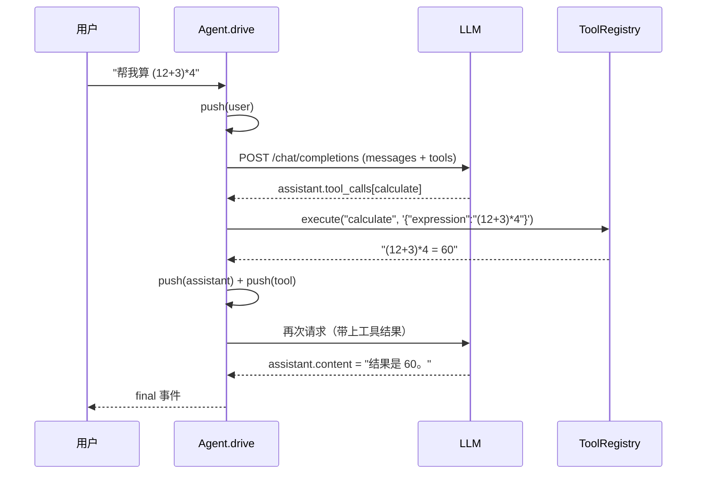

# 01 工作原理

## 一句话

**Agent = 模型 + 工具 + 循环。** 模型本身不能读写文件、不能联网、不知道现在几点；它能做的只有一件事：输出一段文本，或者输出「我要调用某个工具，参数是这些」。循环负责执行工具、把结果塞回对话、再问模型一次。

## 1. 消息协议

内部数据结构与 OpenAI Chat Completions 完全一致（`src/agent/messages.ts`），换供应商时只换地址。

| role | 谁产生 | 关键字段 | 说明 |
| --- | --- | --- | --- |
| `system` | 我们 | `content` | 行为契约：工具怎么用、输出什么形状 |
| `user` | 用户 | `content` | 本轮输入 |
| `assistant` | 模型 | `content` / `tool_calls` | 只调工具时 `content` 为 `null` |
| `tool` | 我们 | `tool_call_id` / `content` | 工具执行结果，必须对应某次调用 |

一次完整往返长这样：

```json
[
  { "role": "system", "content": "你是…" },
  { "role": "user", "content": "帮我算 (12+3)*4" },
  { "role": "assistant", "content": null,
    "tool_calls": [{ "id": "call_1", "type": "function",
      "function": { "name": "calculate", "arguments": "{\"expression\":\"(12+3)*4\"}" } }] },
  { "role": "tool", "tool_call_id": "call_1", "name": "calculate", "content": "(12+3)*4 = 60" },
  { "role": "assistant", "content": "结果是 60。" }
]
```

两条硬约束，违反会被接口直接拒绝：

1. `tool_calls` 里的 `arguments` 是 **JSON 字符串**，不是对象；
2. 每个 `tool_call_id` 都必须有且只有一条 `tool` 消息回应，且紧跟在对应的 `assistant` 之后。

## 2. 一次工具调用的时序



关键点：**模型看不到工具的返回值，除非我们把它写回 `messages`。** 整个 agent 的「记忆」就是这一个数组。

## 3. 核心循环

`src/agent/agent.ts` 的 `drive()`，去掉事件发射后就是：

```ts
messages.push({ role: 'user', content: input });

for (let step = 1; step <= maxSteps; step++) {
  const response = await llm.chat({ messages, tools: registry.schemas() });
  messages.push(response.message);

  const calls = response.message.tool_calls ?? [];
  if (calls.length === 0) return response.message.content;   // 没有工具调用 = 收尾

  for (const call of calls) {
    const result = await registry.execute(call.function.name, call.function.arguments);
    messages.push({ role: 'tool', tool_call_id: call.id, content: result.content });
  }
}
```

三个容易忽略的设计决定：

**为什么把 `tools` 每轮都传？** 模型不知道工具存在就不会调用。工具声明的 `description` 就是给模型的说明书，写得含糊，调用就会出错。

**为什么循环要有上限？** 模型可能反复调用同一个失败的工具。`AGENT_MAX_STEPS` 是成本与死循环的双保险。

**上限到了怎么办？** 不是直接报错，而是**撤掉工具再问一次**（`callModel(..., withTools = false)`），并追加一句「请直接基于已有信息回答」。用户永远能拿到结论，而不是一个空转的会话。

## 4. 流式为什么麻烦

非流式：一次 JSON 响应，`choices[0].message` 直接可用。

流式（SSE）：服务端一段段推 `data: {...}\n\n`，最后 `data: [DONE]`。文本增量好办，**工具调用是碎的**：

```text
data: {"choices":[{"delta":{"tool_calls":[{"index":0,"id":"call_1","function":{"name":"calc"}}]}}]}
data: {"choices":[{"delta":{"tool_calls":[{"index":0,"function":{"name":"ulate"}}]}}]}
data: {"choices":[{"delta":{"tool_calls":[{"index":0,"function":{"arguments":"{\"expr"}}]}}]}
data: {"choices":[{"delta":{"tool_calls":[{"index":0,"function":{"arguments":"ession\":\"(12+3)*4\"}"}}]}}]}
```

名字被切成 `calc` + `ulate`，参数被切成两段。所以客户端必须按 `index` 归位、逐字段累加（`src/agent/llm.ts` 的 `readStream`，用 `Map<number, ToolCall>`）。

另一个坑：**网络分包不按事件边界切**。一个 `data:` 行可能被拆到两次 `read()` 里，所以要先缓冲再按 `\n\n` 切块（`sseEvents`）。

最后是输出层的分工：`delta` 事件实时落屏，`final` 事件只负责收尾。如果两者都打印，用户会看到两遍回答。

## 5. 失败的处理

| 失败类型 | 处理方式 | 位置 |
| --- | --- | --- |
| 网络错误 / 超时 / 401 | 抛 `LLMError`，交给 UI 显示，本轮结束 | `llm.ts` |
| 工具不存在、参数不是 JSON、参数校验失败 | 转成 `ok:false` 的**工具结果文本**回填，让模型自己修正 | `registry.ts` |
| 工具内部异常（文件不存在等） | 同上，不中断对话 | `registry.ts` |
| 模型反复调用工具 | 步数上限 + 强制收尾 | `agent.ts` |
| 历史过长 | 按条数裁剪，且**不能裁在 `tool` 消息前** | `agent.ts#trimHistory` |

「工具失败也当结果返回」是这个设计里最重要的一条：模型看到 `参数校验失败：arguments.expression 缺失` 之后，下一轮通常就改对了。如果直接抛异常，用户看到的是崩溃，而不是答案。

裁剪为什么特殊：如果截断后第一条是 `tool` 消息，它对应的 `assistant(tool_calls)` 已经被丢掉，接口会报「tool 消息没有对应调用」。所以裁剪时向前跳过连续的 `tool` 消息。

## 6. 代码地图

| 想知道什么 | 读哪里 |
| --- | --- |
| 循环怎么转 | `src/agent/agent.ts` → `drive()` |
| 流式怎么拼 | `src/agent/llm.ts` → `readStream()` / `sseEvents()` |
| 工具怎么注册、怎么防错 | `src/tools/registry.ts` |
| 参数怎么校验 | `src/tools/schema.ts` |
| 沙箱怎么防越界 | `src/tools/fs.ts` → `resolveInsideWorkspace()` |
| 终端怎么渲染事件 | `src/cli/repl.ts` → `printEvents()` |
| 会话怎么落盘 | `src/memory/store.ts` |

## 7. 为什么不用 SDK 和框架

学习项目里，SDK 会藏掉恰好最该看的部分：请求体长什么样、SSE 怎么拼、工具调用怎么回填。`src/agent/llm.ts` 只有 250 行，但它就是协议本身。

工程上该用 SDK：重试、限流、多模态、结构化输出都有现成的。等你把这些行为都理解一遍之后再换，迁移成本约等于改一个 `LLMClient` 实现——接口只有 `chat(request): Promise<ChatResult>`。
